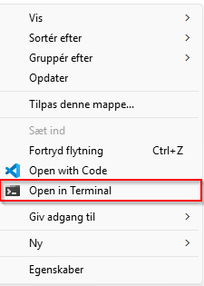
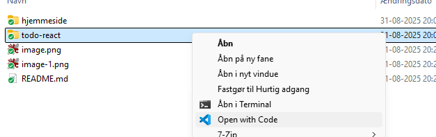
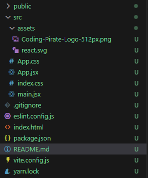

# HTML / Javascript

HTML, CSS og Javascript tillader dig at lave

## HTML + CSS + Javascript (for nybegyndere)

### Lav din egen hjemmeside

Læs guiden her [Guiden](./hjemmeside/README.md)

## React Todo app (for avancerede)

Denne todo app er bygget i React, som er et Javascript baseret framework/værktøjskasse til at lave store web applikationer.

React er rimelig avanceret, og du skal nok have lidt erfaring med at prorgammere inden du springer direkte I. Til gengæld kan du lave rigtig flotte hjemmesider, der er meget mere dynamiske end HTML. Se f.eks.

<https://simonvu.dk>

<https://facebook.com>

<https://bbc.com>

### Opsætning

For at køre React skal du først installere følgende programmer:

Nodejs - <https://nodejs.org/en/download>

VSCode - <https://code.visualstudio.com/>

Find et godt sted til din kode og start en terminal ved at højreklikke og åbne terminalen (eller alternaivt Powershell)



Kør følgende kommando:

```powershell
# Opretter en ny mappe med et React projekt med navn 'todo-react'
npm create vite@latest todo-react -- --template react
```

Åben mappen i VSCode ved at højreklikke mappen og åbne i Code



Åben terminalen i VSCode ved at taske `CTRL + Æ`

Download de nødvendige NPM pakker ved at køre kommandoen

```powershell
npm install
```

### Basiskodning

Du skulle nu gerne have en mappe som ser nogenlunde sådan ud.



Du kan køre din kode ved at åbne en terminal og bruge kommandoen

```powershell
npm run dev
```

Hjemmesiden kan nu åbnes ved at trykke på linket i terminalen eller via en browser `http://localhost:5173`

Gå til [Guiden](./todo-react/README.md)
