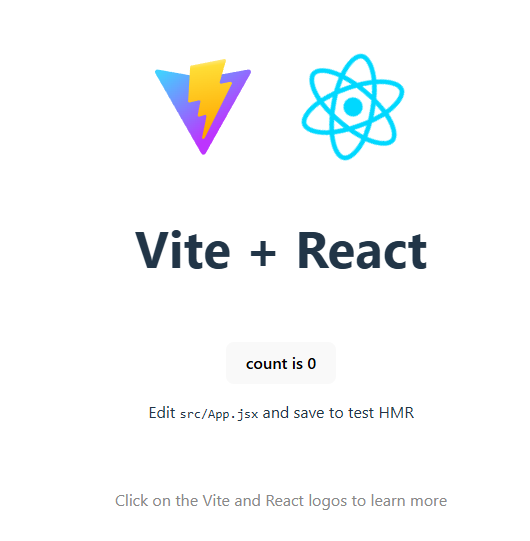

# Todo app

Denne todo app er bygget i React, som er et Javascript baseret framework/værktøjskasse til at lave store web applikationer.

Brug koden her som inspiration, hvis du sidder fast.

## Første program

Når du har opsat React for første gang, så burde du se følgende:

Appen ligger i `App.jsx` og det er også i denne fil at du skal lave ændringer. Prøv at ændre overskriften i `<h1>` tagget til noget andet og gem via `CTRL + S`. Læg mærke til hvordan appen ændrer sig automatisk. Dette hedder hot-reload.

## Opgaver til basis react projekt

- Skift titlen af hjemmesiden til noget andet
- Prøv at få count til at gå op med mere end 1 ad gangen
- Sæt et billede af din ynglingsperson ind
  - Hint: `import billede from './assets/billede.png';`
  - Hint2: ``
- Gør hjemmesiden dark-mode (husk at tekst skal skifte farve)

## Opgaver som udvidelse af TODO Appen

- Gør sådan at man ikke kan have 2 af samme TODO
- Udvid todo-appen så du også kan slette TODOs
- Lav en counter som kan vise, hvor mange TODOs der er blevet oprettet i alt, samt hvor mange der er slettet
